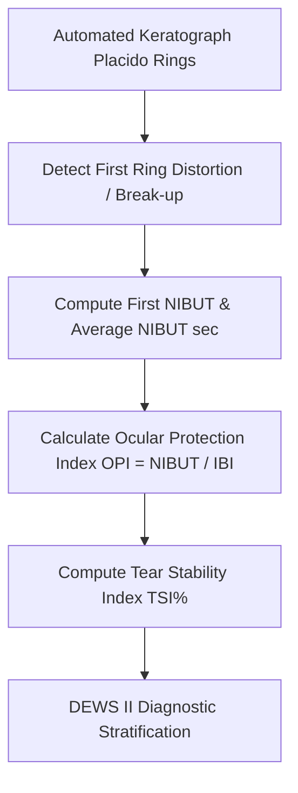

# Ocular Non-Invasive Tear Film Break-Up Time (NIBUT) Personal Agent Skill

[](LICENSE)
[](https://www.python.org/)
[]()
[]()
[]()

Deterministic, zero-mock personal agent micro-skill for calculating Non-Invasive Tear Film Break-Up Time (First NIBUT, Average NIBUT), Ocular Protection Index (OPI), and Tear Stability Index (TSI%) based on TFOS DEWS II diagnostic standards.

## Architecture



## Quickstart

```python
from client import TearFilmBreakupTimeClient

client = TearFilmBreakupTimeClient()
result = client.evaluate_nibut(
    first_break_time_sec=14.5,
    average_break_time_sec=18.2,
    interblink_interval_sec=5.0
)
print(result)
```

## License

Apache-2.0
